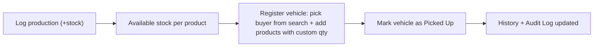

# Steel Factory E2E Management System

An internal, cloud-hosted, mobile-responsive web application to track daily steel production, dispatch vehicles carrying multiple products to buyers, and maintain full history and audit logs — with granular permission-based user access.

## Tech Stack

- **Frontend**: React 19 + Vite + TypeScript. Tailwind CSS for styling (mobile-responsive). React Router, TanStack Query, React Hook Form + Zod, custom `SearchableSelect` component.
- **Backend**: NestJS (Node + TypeScript) REST API — modular, with permission guards and audit interceptor.
- **Database**: PostgreSQL (managed via Neon or Supabase) with Prisma ORM.
- **Auth**: JWT-based (access + refresh tokens), passwords hashed with bcrypt. Permission-based access control — no fixed roles.
- **Hosting**: Frontend on Vercel; backend on Render or Railway; database on Neon. HTTPS, accessible from any phone/browser.

## Project Structure (monorepo)

```
apps/
  api/     NestJS REST API
  web/     React + Vite frontend
packages/
  shared/  Shared TypeScript types (Permission, AuthUser, StockBalance, VehicleItemInput)
```

## User Access Model

There are no fixed roles. Every user has:
- `isAdmin: boolean` — full access to everything when true
- `permissions: string[]` — a list of permission keys granting specific capabilities

**Permission keys:**

| Key | What it unlocks |
|-----|----------------|
| `LOG_PRODUCTION` | Log daily production entries |
| `MANAGE_PRODUCTS` | Create / deactivate product types |
| `MANAGE_BUYERS` | Add / update buyers |
| `DISPATCH_VEHICLES` | Register vehicles and mark pickups; view stock |
| `MANAGE_USERS` | Create users and assign permissions |
| `VIEW_AUDIT` | View audit logs |

Admin creates users via `/users` and assigns any combination of permissions. The UI automatically hides nav items and pages the user has no access to.

## Data Model (Prisma)

- `User` (id, name, email, passwordHash, **isAdmin**, **permissions String[]**, timestamps)
- `Product` (id, name, grade, unit, isActive) — created by users with `MANAGE_PRODUCTS`
- `ProductionLog` (id, productId, tonnage, date, operatorId, notes) — increases available stock
- `Buyer` (id, name, contact, address, isActive, createdBy) — **no login**, managed by `MANAGE_BUYERS`
- `Vehicle` (id, buyerId, vehicleNumber, driverName?, driverPhone?, status, registeredBy, pickedUpAt?, notes, timestamps)
- `VehicleItem` (id, vehicleId, productId, tonnage) — one row per product carried in a vehicle
- `AuditLog` (id, userId, action, entity, entityId, before, after, timestamp) — written on every mutation

**Stock formula (derived, no stored balance):**
```
available = produced − committed − dispatched
committed  = sum of VehicleItem.tonnage where Vehicle.status = REGISTERED
dispatched = sum of VehicleItem.tonnage where Vehicle.status = PICKED_UP
```

## Core Workflow



## API Surface (NestJS modules)

| Module | Endpoint(s) | Permission required |
|--------|-------------|---------------------|
| `auth` | POST /auth/login, POST /auth/refresh, GET /auth/me | — |
| `users` | GET/POST/PATCH/DELETE /users | `MANAGE_USERS` |
| `products` | GET /products, POST/PATCH/DELETE /products/:id | `MANAGE_PRODUCTS` (write) |
| `production` | GET/POST /production | `LOG_PRODUCTION` |
| `stock` | GET /stock | authenticated |
| `buyers` | GET /buyers?q=, GET/POST/PATCH /buyers/:id | `MANAGE_BUYERS` (write) |
| `vehicles` | GET/POST /vehicles, PATCH /vehicles/:id/pickup | `DISPATCH_VEHICLES` |
| `audit` | GET /audit?entity=&from=&to= | `VIEW_AUDIT` |

Cross-cutting: `PermissionsGuard` + `AuditInterceptor` on all mutations.

## Key Screens

- **Login** → always redirects to `/home`
- **Home** (`/home`) — permission-aware dashboard; shows quick-action cards only for what the user can access, plus stock summary
- **Production** (`/production`) — log daily tonnage per product; view production history
- **Stock** (`/stock`) — per-product produced / committed / dispatched / available
- **Vehicles** (`/vehicles`) — register a vehicle: search buyer, add multiple product rows each with custom tonnage; history table with "Mark Pickup" action
- **Buyers** (`/buyers`) — searchable list, add/update buyer records (no login for buyers)
- **Products** (`/products`) — create and deactivate product types/grades
- **Users** (`/users`) — create users, toggle `isAdmin`, pick permission checkboxes
- **Audit Logs** (`/audit`) — filterable by entity, date range

## Seed Accounts

| Access | Email | Password | Permissions |
|--------|-------|----------|-------------|
| Admin | admin@factory.com | admin123 | Full (isAdmin) |
| Production Staff | production@factory.com | prod123 | LOG_PRODUCTION |
| Dispatcher | dispatcher@factory.com | dispatch123 | DISPATCH_VEHICLES, MANAGE_BUYERS |

## Mobile Responsiveness

- Mobile-first Tailwind layouts; sidebar on desktop, hamburger drawer on mobile
- Tables collapse to stacked cards on small screens
- Large touch targets (min 44px) on all interactive elements
- TanStack Query caching minimises re-fetches on weak connections
- Test at 360px, 768px, 1280px before each release

## Cost & Portability

- All frameworks are free and open source (React, Vite, NestJS, Prisma, Tailwind, Zod, etc.)
- Estimated hosting cost: $0–10/month (Vercel free, Render/Railway hobby, Neon free)
- No proprietary lock-in: standard PostgreSQL data (portable via `pg_dump`), standard Node backend, open-standard JWT auth

## Out of Scope (v1)

- Offline mode, native mobile apps
- Payments, invoicing, per-product pricing
- SMS / email notifications
- Buyer-facing portal or login
- Server-side pagination for dropdowns (client-side filtering handles current scale)
